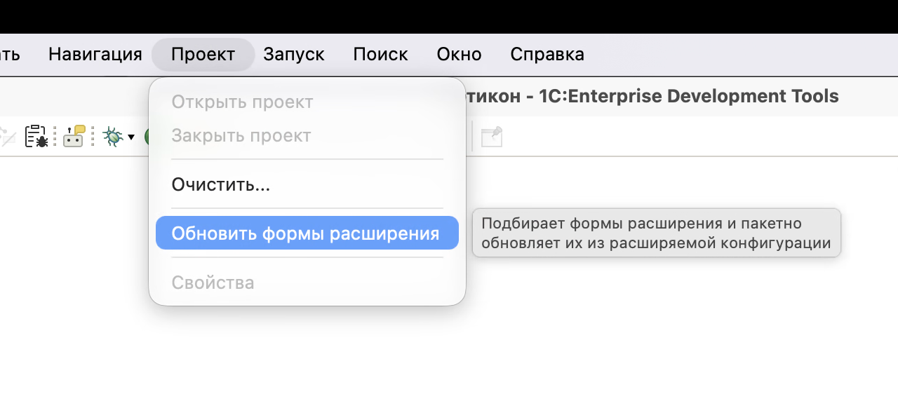
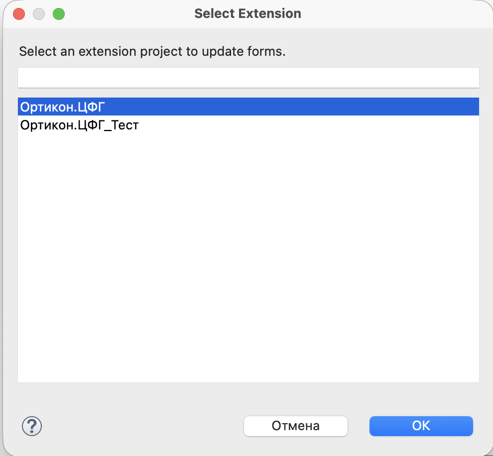
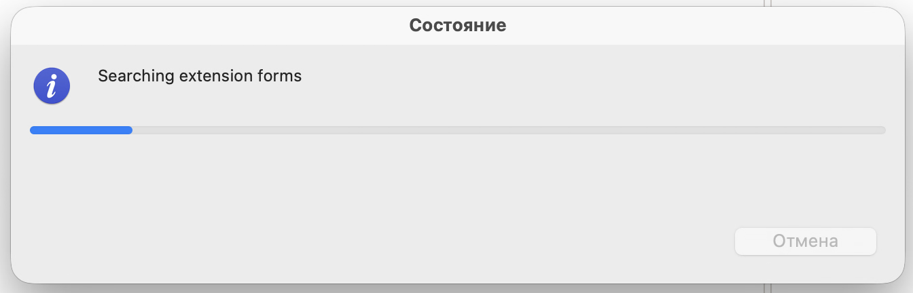
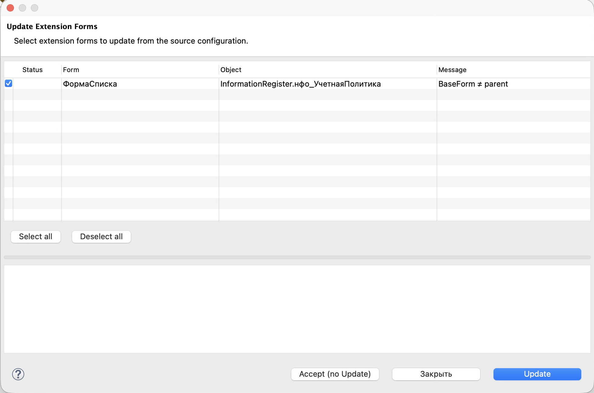
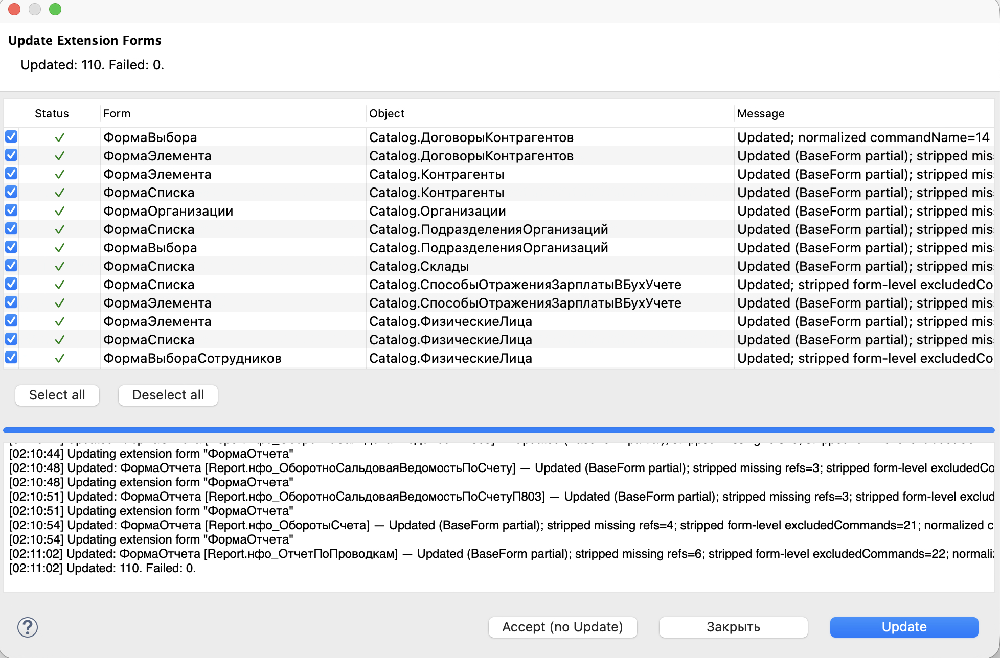

# Плагин обновления форм расширения EDT

Плагин для **1C:EDT 2026.1** и **2026.2**.

После обновления основной конфигурации (СиО или новая версия УМФО) формы в
расширении часто отстают от родителя. Плагин находит такие формы и пакетно
подтягивает снимок из основной конфигурации. Слой доработок расширения при
этом не раздувается.

Публичный форк [Xelgo/edt-form-update-plugin](https://github.com/Xelgo/edt-form-update-plugin).
На EDT 2026.2 стоковый плагин часто не ставится или не находит формы.

Лицензия: **Eclipse Public License 2.0** (`LICENSE`, `NOTICE`).

## Когда пользоваться

После слияния с основной конфигурацией или выкладки новой УМФО, если BaseForm
в расширении устарел относительно Form родителя. Перед коммитом и сборкой
расширения прогоните Update по отмеченным формам и проверьте экспорт проекта.

## Как запустить

В EDT откройте меню **Проект**, пункт **Обновить формы расширения**.



Выберите проект расширения (например `Ортикон.ЦФГ`) и нажмите OK.



Подождите поиск форм.



В диалоге появится список кандидатов: форма, объект, сообщение. Часто в
сообщении видно `BaseForm ≠ parent`.



Отметьте нужные строки (или **Select all**) и нажмите **Update**.

## Кнопки в диалоге

**Update** обновляет выбранные формы: BaseForm берётся из родителя,
выравниваются id, чистятся опасные ссылки и form-level `excludedCommands`.
Слой доработок расширения плагин сохраняет. Толстую Form с полями расширения
сверх BaseForm он не пересобирает.

**Accept (no Update)** запоминает текущее состояние без правки файлов, чтобы
список не повторялся, пока родитель снова не изменится.

**Закрыть** выходит без действий.

## Результат

После прогона в шапке видно Updated и Failed. В логе по каждой форме написано,
что сделано. Нормальный исход: `Failed: 0`.



## Установка

Кратко для macOS + EDT 2026.2: jar в `~/.p2/pool/plugins` и строка в
`bundles.info` (одного `dropins/` часто мало).

Подробно: **[docs/INSTALL-EDT-2026.md](docs/INSTALL-EDT-2026.md)**.

Критерий: в меню есть **Проект → Обновить формы расширения**, в `.log` нет
`BundleException` по `formupdate`.

## Сборка из исходников

JDK 17+, Maven 3.8+.

```bash
cd edt-form-update-plugin
mvn -DskipTests clean verify
```

Jar UI-бандла: `bundles/…/target/`. Qualifier Tycho; в `bundles.info` удобнее
`1.0.2.vYYYYMMDDHHMM`.

## Совместимость

| EDT | Этот форк |
|-----|-----------|
| 2026.2 | да (основная цель) |
| 2026.1 | да |
| 2025.x | ориентир — upstream Xelgo |

Java: **17** (`Bundle-RequiredExecutionEnvironment`).

## Что изменено относительно Xelgo

Список патчей и технические детали: **[docs/CHANGES.md](docs/CHANGES.md)**.

Кратко: Update не вызывает EDT `updateAdopted` (не раздувает Form), синхронизирует
BaseForm с родителем по файлам, выравнивает id, чистит опасные `commandName` /
`excludedCommands` / Mac-shortcuts, при необходимости пересобирает Form как
BaseForm + overlays (не срезает поля расширения сверх BaseForm).

## Документация

- [Установка на EDT 2026.1 / 2026.2](docs/INSTALL-EDT-2026.md)
- [Что изменено относительно Xelgo](docs/CHANGES.md)
- [NOTICE (атрибуция EPL)](NOTICE)
